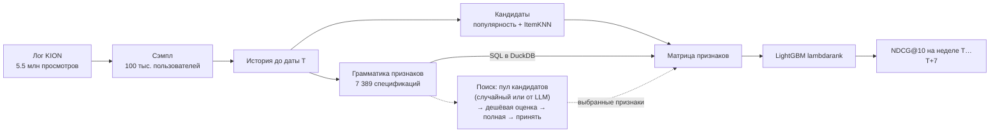
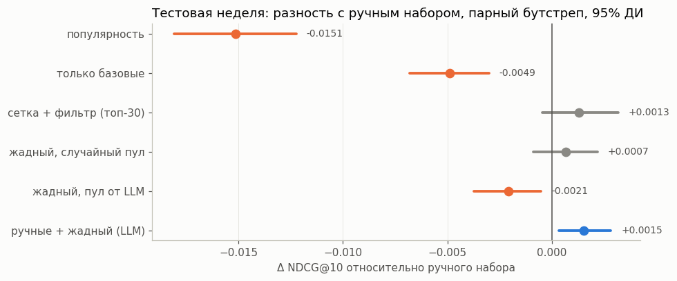
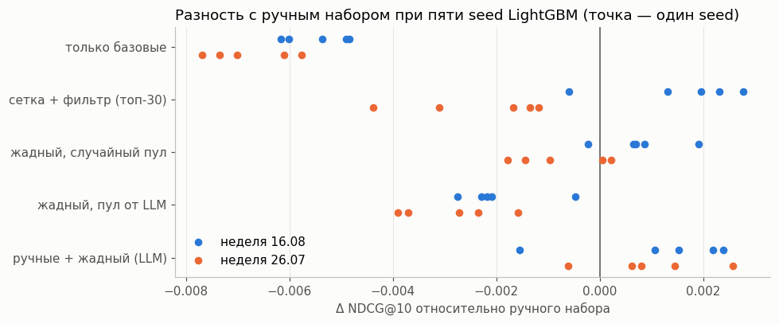
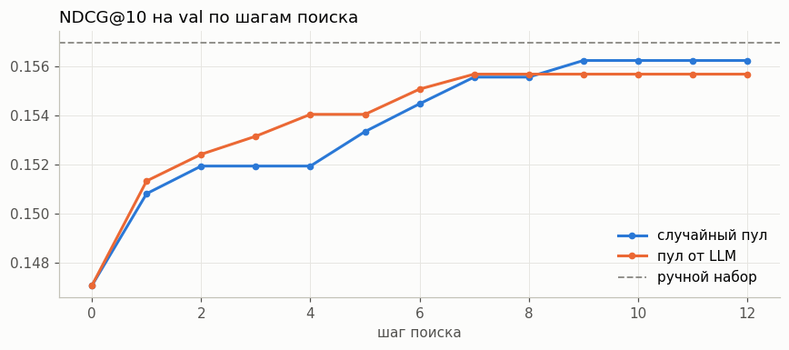
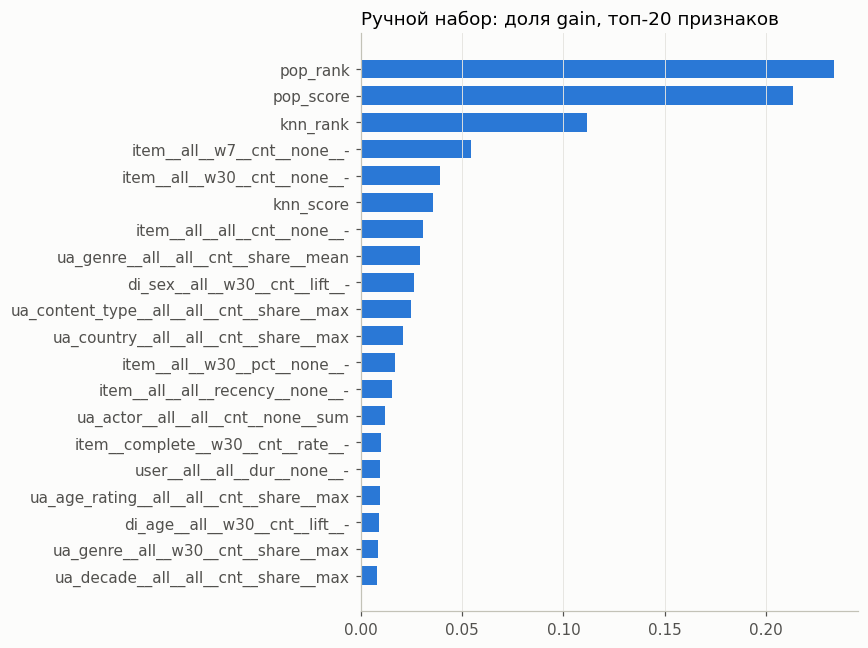
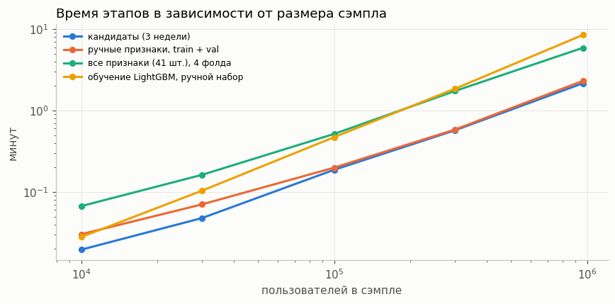
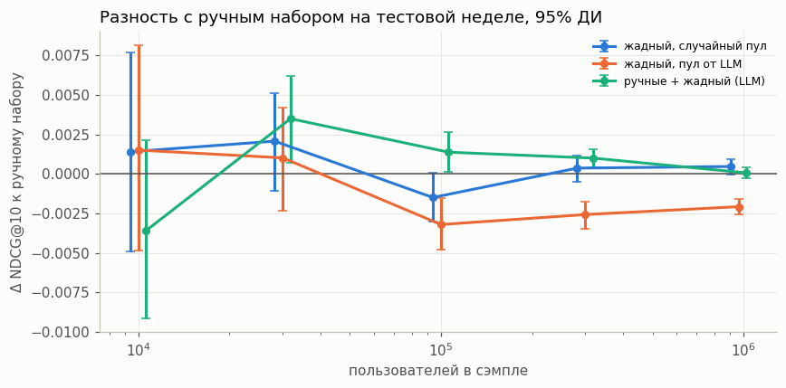

# Автоматическая генерация признаков для ранжирования рекомендаций

Исследование на датасете [KION](https://github.com/irsafilo/KION_DATASET) (МТС): может ли автоматический поиск по пространству признаков заменить ручной feature engineering для LightGBM-ранкера без потери качества.

> **Коротко**
>
> - Признаки-агрегаты описаны грамматикой из 7 389 вариантов, которая компилируется в SQL. Жадный поиск по ней нашёл **6 признаков, которые не хуже 29 ручных**: на полном датасете (962 тыс. пользователей) разность с ручным набором +0.0005 NDCG@10, интервал [−0.0000, +0.0010], то есть возможная потеря качества меньше 0.001 NDCG@10 (около 0.65%). Этот допуск выбран после эксперимента.
> - **Прирост от добавления найденных признаков к ручным не подтвердился:** +0.001 в одном прогоне, около нуля в повторном и +0.0001 на полном датасете.
> - **LLM-агент как генератор кандидатов проиграл:** найденный им набор хуже ручного во всех 20 оценках (2 прогона × 2 недели × 5 `seed`) и на всех размерах выборки от 100 тыс. пользователей (на полном датасете −0.0021), а в среднем хуже и набора из случайного поиска. Это вывод об одной реализации: одна модель, один промпт, один прогон поиска.
> - **Пайплайн масштабируется почти линейно** до полного датасета: расчёт признаков растёт линейно, весь протокол – с показателем 1.17; на 962 тыс. пользователей 80 минут и 17.6 ГБ пика памяти на Kaggle.

Основное исследование – в ноутбуке [solution.ipynb](solution.ipynb), масштабируемость и проверка на полном датасете – в [scalability.ipynb](scalability.ipynb). Здесь краткое изложение.

Готовые версии с выводами на Kaggle: [основной эксперимент](https://www.kaggle.com/code/madina404/recsys-auto-features-main-experiment), [масштабируемость](https://www.kaggle.com/code/madina404/recsys-auto-features-scalability).

## Постановка

- **Задача:** по истории до даты `T` выбрать 10 тайтлов, которые пользователь посмотрит в неделю `[T, T+7)`. Уже просмотренное не рекомендуется.
- **Данные:** случайные 100 тыс. пользователей с полной историей, 573 тыс. просмотров.
- **Разбиение по неделям:** `train` 02–08.08, `val` 09–15.08, `test` 16–22.08.2021. Признаки каждой недели считаются только по событиям до её начала.
- **Двухстадийная схема:** популярность + ItemKNN дают около 170 кандидатов на пользователя (покрывают 44% позитивных пар пользователь–тайтл), LightGBM `lambdarank` их ранжирует.
- **Метрики:** NDCG@10, Recall@10, MAP@10, ROC-AUC, LogLoss. Доверительные интервалы считаются бутстрепом по пользователям, сравнение с ручным набором – парным бутстрепом.

**Прямые связи «пользователь × этот объект» в KION недоступны.** В логах одна строка на пару с датой последнего просмотра, повторные просмотры не видны, а уже просмотренное не рекомендуется. Поэтому персональный сигнал строится из косвенных связей: пользователь × жанр, страна, режиссёр, актёр, тип контента, возрастной рейтинг, десятилетие выпуска, а также демографическая группа × объект.

### Почему нет утечек

- Признаки для недели `[T, T+7)` считаются из таблицы, в которую попадают только события с датой `< T`. Это единственный источник событий для движка признаков. Кандидаты строятся по той же истории.
- Таргет – просмотры с датой `≥ T`, поэтому в признаки он не попадает по построению.
- Тонкость формата KION: в строке хранится дата **последнего** просмотра и накопленная длительность. Если эта дата `< T`, после `T` пару не смотрели, и длительность целиком относится к прошлому. Если `≥ T`, строка выбрасывается из истории целиком. Часть истории теряется, но утечки нет. Полную последовательность просмотров по этим данным восстановить нельзя, поэтому таргет не отличает первый просмотр тайтла от досмотра, начатого до `T`.
- Это проверено двумя тестами. В разделе 3.2 ноутбука: признаки не меняются, если удалить будущие события (тест проверяет только движок признаков). В [leakage_check.ipynb](leakage_check.ipynb) проверяется весь пайплайн: будущие события искажаются (меняются длительности, 30% удаляются, добавляются 20 тыс. фиктивных), а кандидаты, базовые признаки и 163 признака грамматики собираются заново. Всё, что посчитано для пары пользователь–тайтл, совпадает с исходным, хотя таргет заметно меняется.
- Анкеты пользователей и атрибуты тайтлов – снимки на конец датасета. Менялись ли они во времени, по данным проверить нельзя.
- Признаки и гиперпараметры подбирались на `val`, тестовая неделя использована только для итоговой оценки. Валидационная неделя при этом использовалась многократно (подбор `num_leaves` и размера сетки, сотни оценок в поисках), поэтому оценки на `val` оптимистичны.

## Подход

Признаки описываются грамматикой: `(связь, тип события, окно или затухание, агрегация, нормировка, свёртка)`. Например, `ua:genre / complete / h30 / cnt / lift / max` означает «насколько чаще среднего пользователь досматривает жанры кандидата, с затуханием 30 дней». Спецификация компилируется в SQL для DuckDB. Пространство содержит 7 389 допустимых признаков, ручной набор – 29 его точек. Окно и полупериод затухания – параметры грамматики, поэтому вопрос «почему именно 7 дней» решает поиск, а не человек.



Сравниваются:

| Подход | Что делает человек | Как выбираются признаки |
|---|---|---|
| Ручные | придумывает 29 признаков | никак |
| Сетка + фильтр (как DFS) | задаёт сетку из 1 004 признаков | одномерный AUC внутри пользователя, удаление дублей |
| Жадный, случайный пул | задаёт пространство | 12 шагов: 24 кандидата → дешёвая оценка → 4 лучших → полная модель → принять, если NDCG растёт |
| Жадный, пул от LLM | задаёт пространство | то же, но кандидатов предлагает LLM (Nemotron 3 Ultra через OpenRouter), видя историю поиска |

## Результаты

Все цифры получены прогоном ноутбука на Kaggle. Основная тестовая неделя – 16–22.08. Для проверки устойчивости те же замороженные наборы признаков оценены на неделе 26.07–01.08 (разбиение сдвинуто на три недели назад; эти недели в поиске не участвовали, но наборы выбирались по более поздним неделям, так что это проверка устойчивости, а не тест вне времени) и с пятью `seed` LightGBM.

Названия подходов в таблице:
- **жадный** – признаки добавляются по одному: на каждом шаге из кандидатов выбирается тот, что сильнее всего улучшает NDCG на валидации, а уже выбранные не удаляются;
- **случайный пул** – кандидаты на каждом шаге выбираются случайно из всех 7 389 признаков грамматики (затем остаются 24 лучших по AUC внутри пользователя);
- **пул от LLM** – кандидатов на каждом шаге предлагает языковая модель, видя историю поиска;
- **сетка + фильтр** – все признаки фиксированной сетки (окна 7, 30 дней и вся история) отбираются по отдельности, без учёта уже выбранных;
- **Δ к ручным** – разность NDCG@10 с ручным набором на одних и тех же пользователях; если интервал не содержит ноль, разница значима.

| Подход | Признаков | NDCG@10, 16.08 | Δ к ручным, 16.08 [95% ДИ] | Δ к ручным, 26.07 [95% ДИ] | Δ к ручным, среднее по 5 seed (16.08 / 26.07) |
|---|---|---|---|---|---|
| Популярность | 1 | 0.1366 | −0.0151 [−0.0181, −0.0122] | −0.0205 [−0.0236, −0.0177] | – |
| Только базовые признаки | 12 | 0.1468 | −0.0049 [−0.0068, −0.0030] | −0.0061 [−0.0082, −0.0039] | −0.0055 / −0.0068 |
| **Ручные** | 12 + 29 | **0.1517** | – | – | – |
| Сетка + фильтр | 12 + 30 | 0.1530 | +0.0013 [−0.0005, +0.0032] | −0.0012 [−0.0030, +0.0007] | +0.0016 / −0.0023 |
| Жадный, случайный пул | 12 + 6 | 0.1524 | +0.0007 [−0.0009, +0.0022] | +0.0001 [−0.0017, +0.0018] | +0.0008 / −0.0008 |
| Жадный, пул от LLM | 12 + 6 | 0.1496 | −0.0021 [−0.0037, −0.0005] | −0.0037 [−0.0055, −0.0019] | −0.0020 / −0.0028 |
| Ручные + жадный (LLM) | 12 + 35 | **0.1532** | +0.0015 [+0.0003, +0.0028] | +0.0026 [+0.0012, +0.0040] | +0.0011 / +0.0010 |

Интервалы в скобках учитывают случайность выборки пользователей (парный бутстреп, `seed` LightGBM = 42). Последняя колонка – среднее по пяти `seed` LightGBM: стандартное отклонение NDCG@10 одного и того же набора при смене `seed` от 0.0002 до 0.0016, то есть того же порядка, что разности между подходами. Поправка на множественные сравнения (пять подходов против ручного) не делалась. Устойчивые выводы она не меняет: интервалы LLM-набора и «только базовых» далеки от нуля, а незначимые разности остаются незначимыми.



Синий – значимо лучше ручного набора, оранжевый – значимо хуже, серый – в пределах шума. Ниже та же разность для каждого из пяти `seed` на двух тестовых неделях: у LLM-набора все точки левее нуля, у объединения в этом прогоне 8 из 10 правее (в повторном прогоне 6 из 10, см. ниже).



Траектории поиска на валидации: оба генератора пула доходят почти до уровня ручного набора (пунктир) за 7–9 шагов.



LogLoss бинарной постановки на неделе 16.08: константа – 0.0417, базовые – 0.0370, ручные – 0.0358, жадный поиск – 0.0361, ручные + жадный – 0.0358. ROC-AUC и LogLoss считаются по парам из списка кандидатов.

Вычислительные затраты на ноутбуке с i3-1215U без GPU: сетка – 4 минуты, жадный поиск – около 40 минут, LLM-поиск – 45 минут, из них 24 минуты ожидания ответов бесплатной модели.

### Какие признаки дают прирост

- **Абляция ручного набора** (NDCG@10 на `val` без группы): связи пользователь × атрибуты объекта −0.0029, признаки объекта −0.0017, демография × объект −0.0016, признаки пользователя −0.0010. Признаки пользователя слабее всего, потому что одинаковы для всех кандидатов одного пользователя.
- **Что выбрали поиски:** досматриваемость и суммарное время просмотра объекта, популярность среди пользователей того же пола, доля жанров, стран, актёров и десятилетий кандидата в истории пользователя. Ни один поиск не выбрал признаки уровня пользователя. Случайный поиск взял окна от 7 до 60 дней и затухание `h7`, LLM-поиск – затухание `h14` в четырёх признаках из шести.
- **Важность в модели на ручном наборе:** наверху скоры генераторов кандидатов и популярность объекта, затем связи пользователя с жанрами, типом контента и странами.



## Масштабируемость и повторный прогон

### Полный датасет

Наборы признаков, найденные на сэмпле 100 тыс. пользователей, применены к выборкам от 10 тыс. до всех 962 тыс. пользователей ([scalability.ipynb](scalability.ipynb), Kaggle). Протокол оценки тот же, поиск заново не запускался.

| Пользователей | Событий | Весь протокол, мин | Признаки (4 фолда), мин | LightGBM, мин | Пик памяти, ГБ |
|---|---|---|---|---|---|
| 10 тыс. | 56 тыс. | 0.4 | 0.07 | 0.03 | 0.9 |
| 30 тыс. | 170 тыс. | 1.1 | 0.16 | 0.10 | 1.5 |
| 100 тыс. | 573 тыс. | 4.2 | 0.52 | 0.47 | 2.9 |
| 300 тыс. | 1.7 млн | 18.3 | 1.73 | 1.85 | 6.8 |
| 962 тыс. (все) | 5.5 млн | 79.8 | 5.88 | 8.47 | 17.6 |

Расчёт кандидатов и признаков растёт линейно (показатель степени 0.94–1.04), обучение LightGBM чуть быстрее линейного (1.25), память – как корень из числа пользователей. Полный датасет не помещается на ноутбуке с 8 ГБ, но помещается в 30 ГБ Kaggle.



Разность NDCG@10 с ручным набором на тестовой неделе 16.08 (на полном датасете в тесте 111 тыс. пользователей, поэтому интервалы узкие):

| Пользователей | В тесте | Только базовые | Жадный, случайный пул | Жадный, пул от LLM | Ручные + жадный (LLM) |
|---|---|---|---|---|---|
| 10 тыс. | 1 154 | −0.0029 | +0.0014 | +0.0015 | −0.0036 |
| 30 тыс. | 3 422 | −0.0029 | +0.0021 | +0.0010 | +0.0035 |
| 100 тыс. | 11 425 | −0.0063 | −0.0015 | −0.0032 | +0.0014 |
| 300 тыс. | 34 727 | −0.0077 | +0.0004 | −0.0026 | +0.0010 |
| 962 тыс. (все) | 111 240 | **−0.0096** [−0.0102, −0.0091] | +0.0005 [−0.0000, +0.0010] | **−0.0021** [−0.0026, −0.0016] | +0.0001 [−0.0003, +0.0004] |



На полном датасете, где 90% пользователей поиск не видел, жадный набор из 6 признаков остаётся на уровне ручного (интервал содержит ноль, верхняя граница +0.0010), LLM-набор значимо хуже, а прирост от объединения исчез. Вероятное объяснение, которое не проверялось: найденные признаки подобраны под пользователей и недели поискового сэмпла.

### Два независимых прогона основного ноутбука

Основной ноутбук выполнен на Kaggle дважды с одинаковыми настройками. Цифры в репозитории взяты из первого прогона. Среднее по пяти `seed` разности NDCG@10 с ручным набором (16.08 / 26.07):

| Подход | Прогон 1 | Прогон 2 |
|---|---|---|
| Только базовые признаки | −0.0055 / −0.0068 | −0.0072 / −0.0058 |
| Сетка + фильтр | +0.0016 / −0.0023 | −0.0010 / +0.0007 |
| Жадный, случайный пул | +0.0008 / −0.0008 | +0.0002 / +0.0004 |
| Жадный, пул от LLM | −0.0020 / −0.0028 | −0.0039 / −0.0013 |
| Ручные + жадный (LLM) | +0.0011 / +0.0010 | −0.0003 / +0.0010 |

Повторяются три вывода: агрегаты нужны, LLM-набор хуже ручного (положительной разности нет ни в одной из 20 комбинаций), жадный набор на уровне ручного. Знак меняется у сетки с фильтром и у объединения, поэтому их преимущество нельзя считать установленным. Прогоны не совпадают побитово, и причины найдены в коде:

- `popular_candidates` сортирует тайтлы по популярности без второго ключа, поэтому при равной популярности меняются состав кандидатов на границе топ-100 и ранги;
- `sample_train` назначает случайные числа по позиции строки, а порядок строк после `full join` в `build_candidates` не фиксирован, поэтому обучающая выборка меняется даже при том же `seed`.

Это подтверждено в [leakage_check.ipynb](leakage_check.ipynb): два одинаковых запуска дают кандидатов, совпадающих на 99.8–99.95%. Исправление – сортировка с явным вторым ключом (`item_id`) и сортировка перед назначением случайных чисел. В код оно не внесено, чтобы код совпадал с опубликованными результатами.

## Выводы

1. **Автоматический поиск не хуже ручного набора.** Жадный отбор нашёл 6 признаков, которые на двух тестовых неделях и пяти `seed` отличаются от 29 ручных в среднем на ±0.0008 NDCG@10. На полном датасете разность +0.0005 [−0.0000, +0.0010]: при допуске 0.001 NDCG@10 (около 0.65%, выбран после эксперимента) набор не хуже ручного. На сэмпле 100 тыс. интервалы шире, и такой вывод там не следует.
2. **Прирост от объединения не подтвердился.** Ручные + найденные признаки: +0.0011 и +0.0010 в первом прогоне (положительны 8 комбинаций из 10), −0.0003 и +0.0010 в повторном (6 из 10), +0.0001 [−0.0003, +0.0004] на полном датасете. Разумно считать это паритетом, а прирост на сэмпле 100 тыс. – частичной подгонкой под его пользователей.
3. **LLM как генератор кандидатов проиграла.** Набор из LLM-поиска хуже ручного во всех 20 оценках (2 прогона × 2 недели × 5 `seed` – это повторные оценки одного найденного набора, а не 20 независимых поисков) и значимо хуже на каждом размере выборки от 100 тыс. (на полном датасете −0.0021). Формат грамматики модель соблюдает (89% допустимых спецификаций), но предложения узкие: 42% кандидатов используют масштаб 14 дней, 15% – бесполезные для ранжирования признаки пользователя, а на части шагов модель вернула неполный список. Вывод относится к этой реализации: одна бесплатная модель, один промпт, один прогон поиска, 211 проверенных кандидатов против 288 у случайного поиска и без предварительного отбора по AUC. Общий вывод о бесполезности LLM для генерации признаков отсюда не следует.
4. **Одномерный фильтр поверх сетки нестабилен.** Он набирает варианты популярности, которые дублируют друг друга; знак его разности с ручным набором меняется между неделями и между прогонами (+0.0016 / −0.0023 в первом прогоне, −0.0010 / +0.0007 во втором).
5. **Поиск выбирает значения, которые человек обычно не перебирает:** затухание с полупериодом 7 и 14 дней, окно 60 дней. Эти значения дали паритет с ручным набором при шести признаках вместо 29, но не превосходство.
6. **Ограничения:** поиск шёл на одном сэмпле 100 тыс. пользователей; сетка окон дискретная (3, 7, 14, 30, 60 дней и затухание с теми же полупериодами), поэтому, например, окно в 10 дней из примера в задании поиск выбрать не мог; случайность обучения (до 0.0016 NDCG) того же порядка, что разности между подходами; порядок подходов на валидации не совпадает с тестом; ранкеры сравнивались при одном размере списка кандидатов (100 + 100), и устойчивость выводов при большем покрытии не проверялась; практическая выгода от 6 признаков вместо 29 (время, память) не измерялась; в данных нет показов и повторных просмотров. Подробнее в разделе 7 ноутбука.

Отдельно описан баг, найденный по ходу работы: прореживание негативов через `shuffle(seed).over('user_id')` применяет одну перестановку ко всем пользователям. Модель от этого была хуже простой популярности (раздел 3.1 ноутбука).

## Где что лежит в ноутбуке

| Что | Где |
|---|---|
| Особенности данных KION, формат «одна строка на пару» | `solution.ipynb`, раздел 1.1 |
| Разбиение по времени, кандидаты, метрики | раздел 2 |
| Движок признаков: грамматика → SQL | раздел 3.1 |
| Тест на отсутствие утечек | раздел 3.2 |
| Ручной набор, бейзлайн LightGBM, абляция | разделы 3.4–3.6 |
| Сетка + фильтр, жадный поиск | разделы 4.2–4.3 |
| LLM-агент и разбор его предложений | разделы 5, 5.1 |
| Сравнение на тестовой неделе, затраты | разделы 6, 6.2 |
| LogLoss, вторая неделя, разброс по seed | разделы 6.4, 6.5, 6.6 |
| Выводы и ограничения | раздел 7 |
| Время, память, полный датасет | `scalability.ipynb` |
| Проверка утечек по всему пайплайну | `leakage_check.ipynb` |

## Как воспроизвести

### На Kaggle (основной способ, им получены все цифры отчёта)

Готовые публичные версии: [основной эксперимент](https://www.kaggle.com/code/madina404/recsys-auto-features-main-experiment) и [масштабируемость](https://www.kaggle.com/code/madina404/recsys-auto-features-scalability). Основной эксперимент опубликован как повторный прогон, поэтому цифры в его выводах отличаются от таблиц в этом README в третьем знаке (см. «Два независимых прогона»). Текст ячеек в нём написан по первому прогону и в части про прирост от объединения устарел; актуальные выводы – в README и в `solution.ipynb` этого репозитория.

1. **Create → New Notebook**, затем **File → Import Notebook → вкладка GitHub**, вставить ссылку на `solution.ipynb` из этого репозитория.
2. В правой панели **Settings → Internet: On**, ускоритель не нужен.
3. **Save Version → Save & Run All** (или **Run All** в редакторе). Первая ячейка сама поставит библиотеки, склонирует репозиторий с кэшем и скачает полный архив KION. Если подключить свой датасет с `interactions.csv`, он будет использован вместо скачивания. Полный прогон вместе с пятью `seed` в разделе 6.6 занимает 1.5–2 часа. Ноутбук `scalability.ipynb` запускается так же (Internet: On) и занимает около двух часов, из них 80 минут – полный датасет.

Ключ API не нужен: в `cache/` закоммичены результаты поисков (`search_*.json`) и все ответы LLM (`llm_log.jsonl`), поэтому поиски не повторяются. Чтобы повторить поиск с нуля, удалите `cache/search_*.json`; для LLM-поиска добавьте ключ OpenRouter в **Add-ons → Secrets** под именем `OPENROUTER_API_KEY`.

Прогоны не совпадают побитово: метрики отличаются в третьем знаке, величина разброса показана в разделе 6.6 ноутбука и в разделе «Два независимых прогона». Наборы признаков одинаковы, они берутся из кэша. Цифры в тексте ячеек основного ноутбука написаны по первому прогону, поэтому в выводах ячеек при повторном запуске они могут слегка отличаться.

### Локально

Нужен Python 3.12 (на 3.14 могут не оказаться сборок части библиотек).

```bash
python -m venv .venv
.venv/Scripts/activate          # Linux/macOS: source .venv/bin/activate
pip install -r requirements.txt
```

Данные. В репозитории KION архив `interactions.csv.zip` обрезан до 50 МиБ; полная версия лежит внутри `data_original.zip`:

```bash
mkdir data
# скачать https://github.com/irsafilo/KION_DATASET/archive/refs/heads/main.zip
unzip main.zip
unzip -j KION_DATASET-main/data_original.zip "data_original/*.csv" -d data/
```

В `data/` должны лежать `interactions.csv` (5 476 251 строка), `users.csv` и `items.csv`. Ноутбук проверяет число строк. Для LLM-поиска ключ OpenRouter кладётся в `.env` (см. `.env.example`). Проверка утечек `leakage_check.ipynb` выполнена локально на сэмпле 20 тыс. пользователей и занимает несколько минут.

Ограничение памяти: локально ноутбук рассчитан примерно на 4 ГБ свободной RAM, DuckDB ограничен 700 МБ и выгружает остальное на диск. На ноутбуке с 8 ГБ лучше закрыть браузер и другие тяжёлые программы.

## Структура

```
solution.ipynb      исследование целиком
scalability.ipynb   время, память и проверка выводов на 10 тыс. – 962 тыс. пользователей
leakage_check.ipynb проверка утечек по всему пайплайну (искажение будущего)
figures/            графики для README
requirements.txt    версии библиотек
.env.example        шаблон для ключа OpenRouter
cache/
  search_*.json     принятые признаки и история каждого поиска
  llm_log.jsonl     все запросы к LLM и ответы
  llm_stats.json    число запросов, токены, доля допустимых ответов
  timings.json      время шагов при первом прогоне без кэша
```
